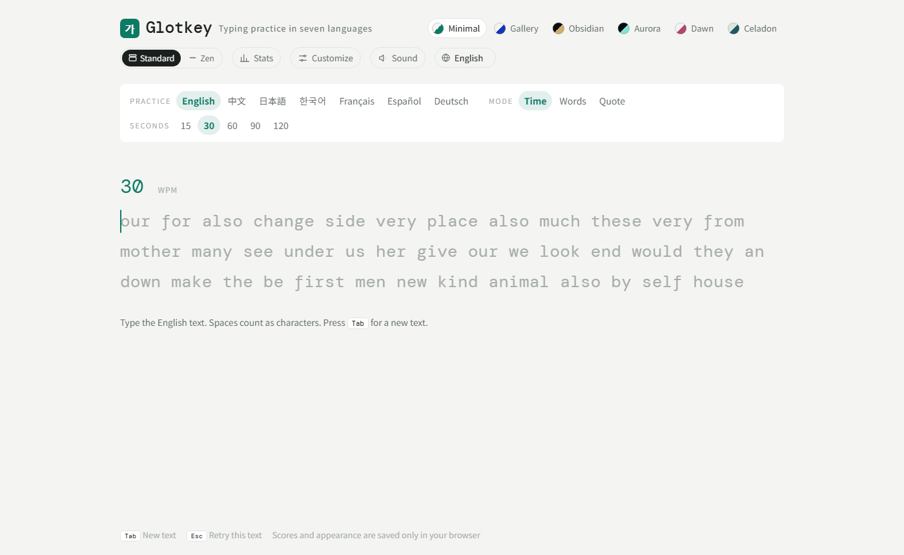

# Glotkey

> **A typing trainer for seven languages that you type on a plain keyboard, with no input method.** Chinese is typed as pinyin, Japanese as romaji and Korean as romanized Hangul, with the original script shown above every word. Everything runs in your browser: no sign-up, no server, and your stats never leave your device.

**🌐 [English](./README.md) · [中文](./README.zh-CN.md)**

[](https://glotkey.com)
[](#languages)
[](#run-it-locally)
[](LICENSE)



## Why Glotkey?

Most typing sites are English-first, and practising Chinese, Japanese or Korean usually means fighting an input method. Glotkey skips the input method: you type the romanization directly, and the characters you are learning sit right above the letters. That turns typing practice into vocabulary practice for language learners, while staying a clean, fast typing test for everyone else.

## Features

### Typing
- **Seven practice languages:** English, 中文 (pinyin), 日本語 (romaji), 한국어 (Revised Romanization), Français, Español, Deutsch.
- **No input method needed:** CJK languages are typed in romanization, with the original script shown above every word.
- **Three modes:**
  - **Time:** 15, 30, 60, 90 or 120 seconds.
  - **Words:** 10, 25, 50 or 100 words.
  - **Quote:** proverbs and classic lines, with pinyin or romaji readings for the CJK languages.
- **Ignore accents:** on by default for French, Spanish and German, so `e` counts for `é`, `n` for `ñ`, and `ß` is spelled `ss`. Turn it off to practise the real letters.
- **Results page:** speed (WPM), accuracy, raw speed, consistency, and a per-second chart with error markers. For CJK it also shows your speed in the original script (characters per minute).

### Your stats, per language
- **Local dashboard:** every finished test is saved in your browser. Filter by language or view everything together.
- **What it shows:**
  - Best speed, last-10 average, average accuracy, total time and characters typed.
  - A speed trend over the last 50 tests, with a 5-test moving average.
  - Practice minutes for each of the last 30 days.
  - Your most-missed characters, counted per language.
  - A side-by-side table of all languages, and your recent tests.
- **Copy all data** as JSON, or clear it with one confirmed click.

### Look and feel
- **Six style presets:** Minimal (follows your light or dark system theme), Gallery, Obsidian, Aurora, Dawn and Celadon.
- **Customizer:**
  - Colors, font (7 families), text size, alignment, visible lines, caret shape, caret smoothing and background effects.
  - Share your theme with a short `TG1.` code that friends paste in to import.
- **Standard / Zen switch:** Zen hides everything except the text, the counter and the language row.
- **Interface in seven languages:** it follows your browser language and can be switched any time.
- **Key sounds:** each preset has its own sound, and they are off by default.

## Languages

| Practice language | You type | Shown above the word |
|---|---|---|
| English | the text itself | — |
| 中文 Chinese | toneless pinyin (`ü` → `v`) | 汉字 |
| 日本語 Japanese | romaji (`kyou`, `ー` → `-`) | 漢字・かな |
| 한국어 Korean | Revised Romanization | 한글 |
| Français | the text (accents optional) | — |
| Español | the text (accents optional) | — |
| Deutsch | the text (umlauts optional, `ß` → `ss`) | — |

## Keyboard shortcuts

| Key | Action |
|---|---|
| `Tab` | New text |
| `Esc` | Retry the same text, or close the stats and customizer panels |

## Run it locally

There is nothing to install and no build step. The whole app is one HTML file.

```bash
git clone https://github.com/kaizhao4333-hub/glotkey.git
cd glotkey
npx serve site
```

Or just open `site/index.html` in your browser.

## Project structure

```
site/            International build: one self-contained index.html (fonts load from Google Fonts)
site-cn/         Mainland-China build: same page, with all fonts bundled locally in site-cn/fonts/
docs/            README assets
netlify.toml     Tells Netlify to publish the site/ folder
```

## Deploying

- **Netlify:** connect this repository. No build command is needed; `netlify.toml` already publishes `site/`.
- **GitHub Pages / any static host:** upload the contents of `site/` (or `site-cn/`).
- **Mainland China:** use `site-cn/`. It makes no requests to Google, so fonts load reliably. Hosting on a mainland server (for example Alibaba Cloud OSS) requires an ICP filing.

## Privacy

Glotkey has no accounts, no analytics and no backend. Settings, best scores and the stats dashboard are stored in your browser's `localStorage`. Clearing site data or switching devices starts you fresh.

## License

[MIT](LICENSE)
