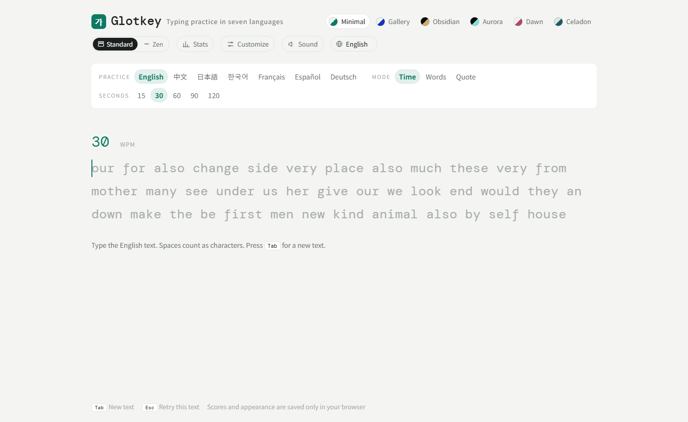

# Glotkey

> **一个支持七种语言的打字练习网站，全程用普通键盘输入，不需要输入法。** 中文打拼音，日语打罗马字，韩语打罗马字拼写，每个词上方都显示原文。所有功能都在浏览器里运行：不用注册，没有服务器，你的统计数据也不会离开你的设备。

**🌐 [English](./README.md) · [中文](./README.zh-CN.md)**

[](https://glotkey.com)
[](#支持的语言)
[](#本地运行)
[](LICENSE)



## 为什么做 Glotkey？

大多数打字网站以英文为主。练中文、日语、韩语，通常还得跟输入法较劲。Glotkey 直接跳过输入法：你打的是拼音或罗马字，正在学的文字就显示在字母上方。对学外语的人来说，打字练习同时也是背单词；对其他人来说，它就是一个干净、流畅的打字测速工具。

## 功能

### 打字
- **七种练习语言：** English、中文（拼音）、日本語（罗马字）、한국어（国语罗马字）、Français、Español、Deutsch。
- **不需要输入法：** 中日韩都用罗马字输入，每个词上方显示原文。
- **三种模式：**
  - **限时：** 15、30、60、90 或 120 秒。
  - **词数：** 10、25、50 或 100 个词。
  - **句子：** 名句和谚语，中日韩句子都配有拼音或罗马字。
- **忽略重音：** 法语、西班牙语、德语默认开启。`e` 可以代替 `é`，`n` 可以代替 `ñ`，`ß` 写作 `ss`。关掉后就能练习真正的特殊字母。
- **成绩页：** 显示速度（WPM）、准确率、原始速度、稳定性，以及标出错误的逐秒速度曲线。中日韩还会换算成原文的每分钟字数。

### 按语言分开的统计数据
- **本地统计面板：** 每次完成的练习都保存在浏览器里，可以按语言筛选，也可以查看全部。
- **面板内容：**
  - 最高速度、最近 10 次平均、平均准确率、总练习时长、累计正确字符数。
  - 最近 50 次的速度趋势，附 5 次移动平均线。
  - 最近 30 天每天的练习时长。
  - 最常打错的字符，按语言分开统计。
  - 各语言对比表，以及最近的练习记录。
- **数据管理：** 可以一键复制全部数据（JSON 格式），也可以在确认后一键清除。

### 外观
- **六种风格预设：** 极简（跟随系统的浅色或深色模式）、画廊、曜石、极光、晨雾、青瓷。
- **自定义面板：**
  - 可以调颜色、字体（7 种）、字号、对齐、显示行数、光标形状、光标平滑和背景效果。
  - 可以生成以 `TG1.` 开头的主题代码分享给朋友，对方粘贴就能导入同样的外观。
- **标准 / 极简界面开关：** 极简界面只保留文字、计数器和语言选择。
- **七种界面语言：** 默认跟随浏览器语言，可以随时切换。
- **按键音效：** 每种风格的声音不同，默认关闭。

## 支持的语言

| 练习语言 | 你要打的 | 上方显示 |
|---|---|---|
| English | 原文 | — |
| 中文 | 不带声调的拼音（`ü` 打 `v`） | 汉字 |
| 日本語 | 罗马字（`kyou`，`ー` 打 `-`） | 汉字・假名 |
| 한국어 | 国语罗马字 | 韩文 |
| Français | 原文（重音可省略） | — |
| Español | 原文（重音可省略） | — |
| Deutsch | 原文（变音可省略，`ß` 写作 `ss`） | — |

## 快捷键

| 按键 | 作用 |
|---|---|
| `Tab` | 换一组 |
| `Esc` | 重打这一组，或关闭统计面板和自定义面板 |

## 本地运行

不需要安装依赖，也不需要构建，整个网站就是一个 HTML 文件。

```bash
git clone https://github.com/kaizhao4333-hub/glotkey.git
cd glotkey
npx serve site
```

也可以直接用浏览器打开 `site/index.html`。

## 项目结构

```
site/            国际版：一个独立的 index.html（字体从 Google Fonts 加载）
site-cn/         中国大陆版：页面相同，所有字体都打包在 site-cn/fonts/ 里
docs/            README 用的图片
netlify.toml     让 Netlify 发布 site/ 文件夹
```

## 部署

- **Netlify：** 连接这个仓库就行。不需要填构建命令，`netlify.toml` 已经设好发布 `site/`。
- **GitHub Pages 或其他静态托管：** 上传 `site/`（或 `site-cn/`）里的文件。
- **中国大陆：** 用 `site-cn/`。它不会请求 Google 的任何资源，字体加载稳定。如果放在大陆的服务器上（比如阿里云 OSS），需要办理 ICP 备案。

## 隐私

Glotkey 没有账号系统，没有统计分析，也没有后端。设置、最佳成绩和统计数据都保存在浏览器的 `localStorage` 里。清除网站数据或换设备后，数据会从零开始。

## 许可证

[MIT](LICENSE)
